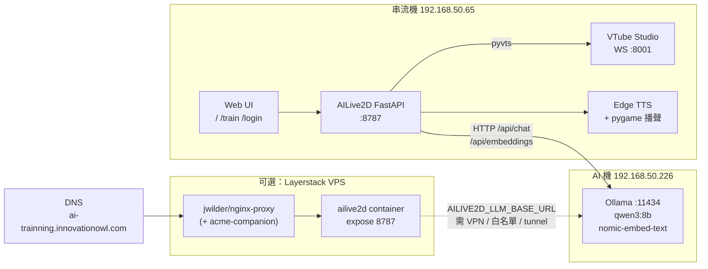
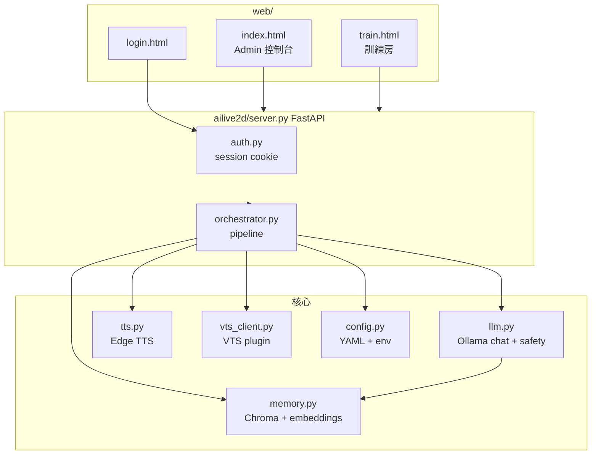
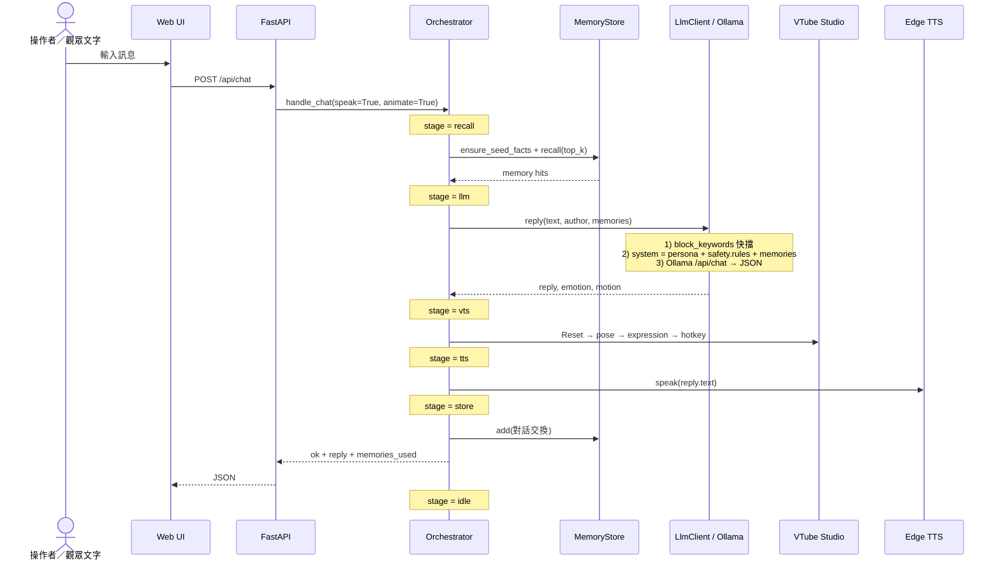
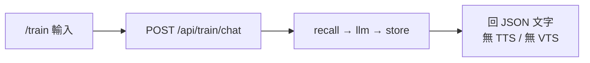
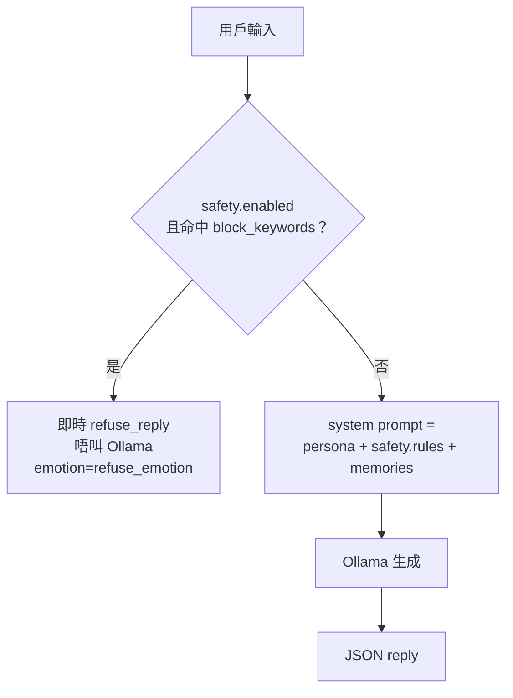
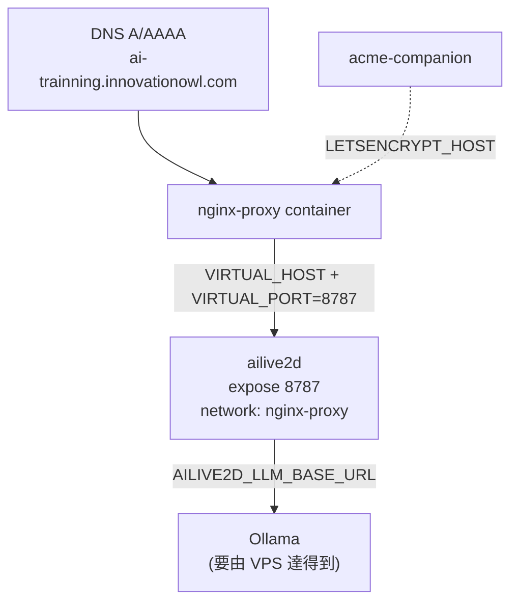

# AILive2D / AIVtuber

粵語 AI VTuber 控制台：本地 Ollama + VTube Studio + Edge TTS，角色 **神崎紫（啊紫 / Yukari）**。風格參考 Neuro-sama——即時對話、表情、語音；再加上長期記憶同直播安全過濾。

> 完整 end-to-end 說明（本檔）。部署速查見 [`docs/deploy.md`](docs/deploy.md)。

---

## 目錄

1. [專案係咩](#1-專案係咩)
2. [硬體同網絡拓撲](#2-硬體同網絡拓撲)
3. [模組地圖](#3-模組地圖)
4. [對話端到端流程](#4-對話端到端流程)
5. [訓練 Chatroom](#5-訓練-chatroom)
6. [安全層（禁語／YouTube）](#6-安全層禁語youtube)
7. [登入同角色權限](#7-登入同角色權限)
8. [設定熱點同環境變數](#8-設定熱點同環境變數)
9. [Config 熱重載（幾乎無 downtime）](#9-config-熱重載幾乎無-downtime)
10. [Docker + nginx-proxy 部署](#10-docker--nginx-proxy-部署)
11. [本機啟動步驟](#11-本機啟動步驟)
12. [預設帳號（上線前請改）](#12-預設帳號上線前請改)
13. [主要 API 一覽](#13-主要-api-一覽)
14. [常見問題](#14-常見問題)

---

## 1. 專案係咩

| 項目 | 說明 |
|------|------|
| 角色名 | 神崎紫（粵語暱稱「啊紫」；英文 Yukari） |
| 語言 | `zh-HK` 粵語口語為主 |
| 目標 | 直播／訓練用 AI VTuber：觀眾打字 → 角色用粵語回覆 + Live2D 表情 + 語音 |
| Repo | https://github.com/ariapurple/AIVtuber |
| 本機路徑（串流機） | `D:\cursorRepos\AILive2D` |

**人設重點（可喺 `config.yaml` → `character.persona` 改）：**

- 傲嬌、鍾意食；語氣懶洋洋、軟軟哋（參考案山子／宵崎奏）
- 叫佢幫手會先嫌麻煩（「欸～又要啊……」），但最後都會做、唔會無故拒絕（安全禁語除外）
- 怕鬼；唔自稱 AI／語言模型
- 回覆短句為主，大約唔超過 60 字；輸出 JSON：`reply` / `emotion` / `motion`

---

## 2. 硬體同網絡拓撲



| 機器 | IP（LAN） | 角色 | 主要埠 |
|------|-----------|------|--------|
| 串流機 DESKTOP-EFAB45U | `192.168.50.65` | 跑本專案 + VTube Studio + TTS 播聲 | App `8787`、VTS `8001` |
| AI / Ollama 機 | `192.168.50.226` | Ollama LLM + embeddings | `11434` |
| Layerstack（可選） | 公網 IP | Docker 訓練／遠端控制台；**通常無 VTS／本機音訊** | 443 via nginx-proxy |

**重點：** Ollama 位址唔係寫死喺程式——`config.yaml` 有 default，正式用 **`AILIVE2D_LLM_BASE_URL`** env 覆蓋（見第 8 節）。

---

## 3. 模組地圖



| 檔案 | 職責 |
|------|------|
| `ailive2d/server.py` | FastAPI：登入閘、靜態頁、API、config 檔案 watcher |
| `ailive2d/orchestrator.py` | 對話 pipeline stages、cancel、demo、reload_config |
| `ailive2d/llm.py` | 組 system prompt（persona + safety + memories）、叫 Ollama、keyword 快擋 |
| `ailive2d/memory.py` | Chroma 持久化向量庫；用 Ollama `nomic-embed-text` embed |
| `ailive2d/tts.py` | Edge TTS（預設 `zh-HK-HiuMaanNeural` rate `-8%`）+ pygame 播放 |
| `ailive2d/vts_client.py` | VTube Studio 插件：連線、hotkey、expression、pose takeover |
| `ailive2d/auth.py` | PBKDF2 密碼、admin / trainer 角色 |
| `ailive2d/config.py` | 讀 `config.yaml`；`AILIVE2D_LLM_BASE_URL` / `AILIVE2D_AUTH` 覆蓋 |
| `web/*` | 登入頁、Admin 控制台、訓練 chatroom |
| `config.yaml` | 人設、安全、LLM/TTS/VTS、帳號 hash（本地可有 secret；repo 用 example） |
| `docker-compose.yml` | jwilder/nginx-proxy `VIRTUAL_HOST` 模式 |

**Pipeline stage 字串（`orchestrator.stage`）：**

`idle` → `recall` → `llm` → `vts` → `tts` → `store` → `idle`  
（另有 `demo`；訓練房跳過 `vts` / `tts`）

---

## 4. 對話端到端流程

Admin 控制台 `POST /api/chat`（會 TTS + VTS）：



**Cancel（軟重置）：** `POST /api/cancel`  
→ 設 `_cancel_requested`、停 TTS、cancel 進行中 task、清 `busy`、stage 返 `idle`。  
各 stage 之間會 `_raise_if_cancelled()`，方便直播途中打斷。

**同一時間只處理一條 pipeline：** `busy=True` 時新請求會回「忙碌中」。

---

## 5. 訓練 Chatroom

用來調人設／禁語，**唔出聲、唔郁 Live2D**。

| 項目 | 值 |
|------|-----|
| UI | `/train` |
| API | `POST /api/train/chat` → `handle_chat(..., speak=False, animate=False)` |
| 歷史 | `GET /api/train/history`（記憶體，最多約 200 條，API 回最近 100） |
| 權限 | `admin` 或 `trainer` |



Trainer 登入後只可以去 `/train` 相關路徑；撞去 `/` 會被 redirect。

---

## 6. 安全層（禁語／YouTube）

三層（由快到慢）：



1. **`safety.block_keywords`**（`llm.py` `_keyword_block`）：字串包含即擋，用 `refuse_reply`。
2. **`safety.rules`**：寫入 system prompt，叫模型遵守（YouTube 社群守則、歧視、政治敏感、色情、犯罪教學、越獄等）。
3. **`character.persona`**：角色口吻同「踩線用軟軟口吻轉話題」。

預設拒絕口吻類似：「欸～呢啲唔好講啦……嗯，不如傾返食嘢同日常？」；`refuse_emotion` 預設 `shy`。

> 改禁語／人設只要存 `config.yaml`——約 2 秒內 hot-reload，直播唔使停機（見第 9 節）。

---

## 7. 登入同角色權限

- Session：`starlette.middleware.sessions.SessionMiddleware`
- Cookie 名：`ailive2d_session`（可改）
- Secret：`AILIVE2D_SECRET` env **優先於** `config.yaml` 嘅 `auth.secret`
- 密碼：PBKDF2-HMAC-SHA256（120k iterations）+ salt，存 hash

| 角色 | 可做 | 唔可以 |
|------|------|--------|
| **admin** | 全控制台、`/api/chat`、VTS、TTS、memory、demo、config reload | — |
| **trainer** | `/train`、`/api/train/*`、`/api/me`、logout、cancel | Admin 頁、直播 chat、VTS 操作 |

公開路徑（唔使登入）：`/login`、`/api/login`、`/api/health`、`/static/*`。  
`AILIVE2D_AUTH=0` 可關閉認證（只建議本機）。

---

## 8. 設定熱點同環境變數

### `config.yaml` 主要區塊

| 區塊 | 用途 |
|------|------|
| `llm` | `base_url`、`model`（如 `qwen3:8b`）、`timeout_sec` |
| `tts` | `voice`（如 `zh-HK-HiuMaanNeural`）、`rate`（如 `-8%`）、`audio_device` |
| `vts` | host/port、plugin、hotkeys／expressions 對應 emotion |
| `character` | `name`、`language`、`persona`（長文人設） |
| `memory` | Chroma `persist_dir`、`embed_model`、`top_k` |
| `safety` | `rules`、`block_keywords`、`refuse_reply` |
| `server` | `host` / `port`（本機預設 `127.0.0.1:8787`） |
| `auth` | users、secret、cookie_name |

參考模板：`config.example.yaml`（唔好把真實 session secret commit 上去）。

### 環境變數覆蓋

| 變數 | 作用 |
|------|------|
| `AILIVE2D_LLM_BASE_URL` | **覆蓋** `llm.base_url`（Ollama；唔 hardcode） |
| `AILIVE2D_SECRET` | Session 簽名密鑰（部署必改） |
| `AILIVE2D_AUTH` | `0`/`false` 關閉登入閘 |
| `AILIVE2D_HOST` / `AILIVE2D_PORT` | bind address（Docker 用 `0.0.0.0:8787`） |
| `VIRTUAL_HOST` / `LETSENCRYPT_HOST` | nginx-proxy 域名 |
| `NGINX_PROXY_NETWORK` | external network 名（預設 `nginx-proxy`） |

---

## 9. Config 熱重載（幾乎無 downtime）

直播撞禁語要改人設／keyword 時：

1. **自動：** `server.py` 每 ~2 秒 poll `config.yaml` mtime；有變更就 `orchestrator.reload_config()`（再等 ~0.4s 等編輯器寫完）。
2. **手動：** `POST /api/config/reload`（要 admin）。

**改完即生效（唔使停 process）：** persona、safety、LLM model／base_url、TTS voice／rate、VTS hotkey 對照、auth **users** 列表。

**仍然要完整 restart：**

| 變更 | 原因 |
|------|------|
| `auth.secret` / `AILIVE2D_SECRET` | Session cookie 簽名 |
| `memory.persist_dir` | Chroma 路徑 |
| `vts.host` / `vts.port` | WebSocket 位址 |
| 任何 Python code | 要重新 load module |

進行中嗰輪對話可能仍用舊 prompt，下一輪先用新設定。Cancel 可以打斷當前輪。

---

## 10. Docker + nginx-proxy 部署

做法同舊專案 `E:\works\trpg`：**唔喺本 stack 起 nginx**，只 join 而家嘅 `jwilder/nginx-proxy`。



`docker-compose.yml` 重點：

- `VIRTUAL_HOST` / `LETSENCRYPT_HOST` = `ai-trainning.innovationowl.com`
- `VIRTUAL_PORT=8787`；只用 `expose`，**唔 publish** host port（避免同其他 stack 撞）
- `networks.nginx-proxy` = `external: true`
- volume：`config.yaml`（ro）+ named volume `ailive2d-data`

```bash
git clone https://github.com/ariapurple/AIVtuber.git
cd AIVtuber
cp .env.example .env
# 填 AILIVE2D_SECRET、AILIVE2D_LLM_BASE_URL、LETSENCRYPT_EMAIL
docker compose up -d --build
```

打開：`https://ai-trainning.innovationowl.com/login`

**注意：** Container 通常連唔到串流機 VTS／本機喇叭——Docker 適合 **文字訓練同遠端 admin**。正式直播表情＋語音請喺串流機本機跑。

`docker compose down` 只會停本專案；唔好 down 共用嘅 nginx-proxy。

---

## 11. 本機啟動步驟

**前置：**

1. AI 機開 Ollama，拉好模型：`qwen3:8b`、`nomic-embed-text`
2. 串流機開 VTube Studio，開 API（預設 `127.0.0.1:8001`），第一次連插件要喺 VTS 允許
3. Python 3.12+、麦克风／耳機（TTS）

```powershell
cd D:\cursorRepos\AILive2D
python -m venv .venv
.\.venv\Scripts\Activate.ps1
pip install -r requirements.txt
# 可選：複製 config.example.yaml → config.yaml 再改
python run.py
# 或 start.ps1
```

瀏覽器：`http://127.0.0.1:8787/login`

確認狀態：Admin 控制台看 LLM ping、VTS connected、memory count。

---

## 12. 預設帳號（上線前請改）

| 帳號 | 預設密碼 | 角色 |
|------|----------|------|
| `admin` | `yukari-admin` | 全控制台 + 訓練房 |
| `trainer` | `yukari-train` | 只 `/train` |

**公開／VPS 前務必：**

1. 改 `config.yaml` → `auth.users` 密碼（或重新生成 hash）
2. 設強隨機 `AILIVE2D_SECRET`
3. 唔好把真實 secret／token（`.vts_token.txt`）commit 上 git

詳見 [`docs/deploy.md`](docs/deploy.md)。

---

## 13. 主要 API 一覽

| Method | Path | 權限 | 說明 |
|--------|------|------|------|
| GET | `/api/health` | public | 健康檢查 |
| POST | `/api/login` | public | 登入 |
| POST | `/api/logout` | session | 登出 |
| GET | `/api/me` | session | 當前用戶 |
| GET | `/api/status` | admin | LLM／VTS／TTS／memory／pipeline |
| POST | `/api/chat` | admin | 完整對話（記憶→LLM→VTS→TTS→存） |
| POST | `/api/train/chat` | admin/trainer | 純文字訓練 |
| GET | `/api/train/history` | admin/trainer | 訓練歷史 |
| POST | `/api/cancel` | admin/trainer | 打斷 pipeline |
| POST | `/api/config/reload` | admin | 手動熱重載 |
| POST | `/api/vts/connect` | admin | 重連 VTS |
| POST | `/api/demo` | admin | 表情演示 |
| POST | `/api/speak` | admin | 只播 TTS |
| POST | `/api/tts` | admin | 改 voice／rate |
| POST | `/api/hotkey` / `/api/hotkeys` | admin | 觸發／儲存 hotkey map |
| POST | `/api/memory/fact` | admin | 寫入事實記憶 |
| POST | `/api/memory/search` | admin | 搜記憶 |

---

## 14. 常見問題

**Q: Ollama IP 係咪 hardcode？**  
A: 唔係。`config.yaml` 只係 default；env `AILIVE2D_LLM_BASE_URL` 會覆蓋。Docker 用 `.env` 設。

**Q: 改禁語要唔要停直播？**  
A: 唔使停 process——改 `config.yaml` 等 ~2 秒，或打 `/api/config/reload`。

**Q: VPS 上點解無表情／無聲？**  
A: VTS 同喇叭喺串流機；container 主要畀訓練同遠端改設定。直播請本機跑。

**Q: 點解回覆要 JSON？**  
A: `llm.py` 要求模型只輸出 `{"reply","emotion","motion"}`，方便驅動 VTS hotkey／expression。

**Q: Memory 用咩？**  
A: 每輪用 Ollama embedding 搜 Chroma 最近 `top_k`（預設 4）段，塞入 prompt；回覆後再 store 對話。

---

## 授權同貢獻

私人／團隊專案（`ariapurple/AIVtuber`）。改人設同安全規則請優先改 `config.yaml`，並依賴熱重載，避免直播 downtime。
